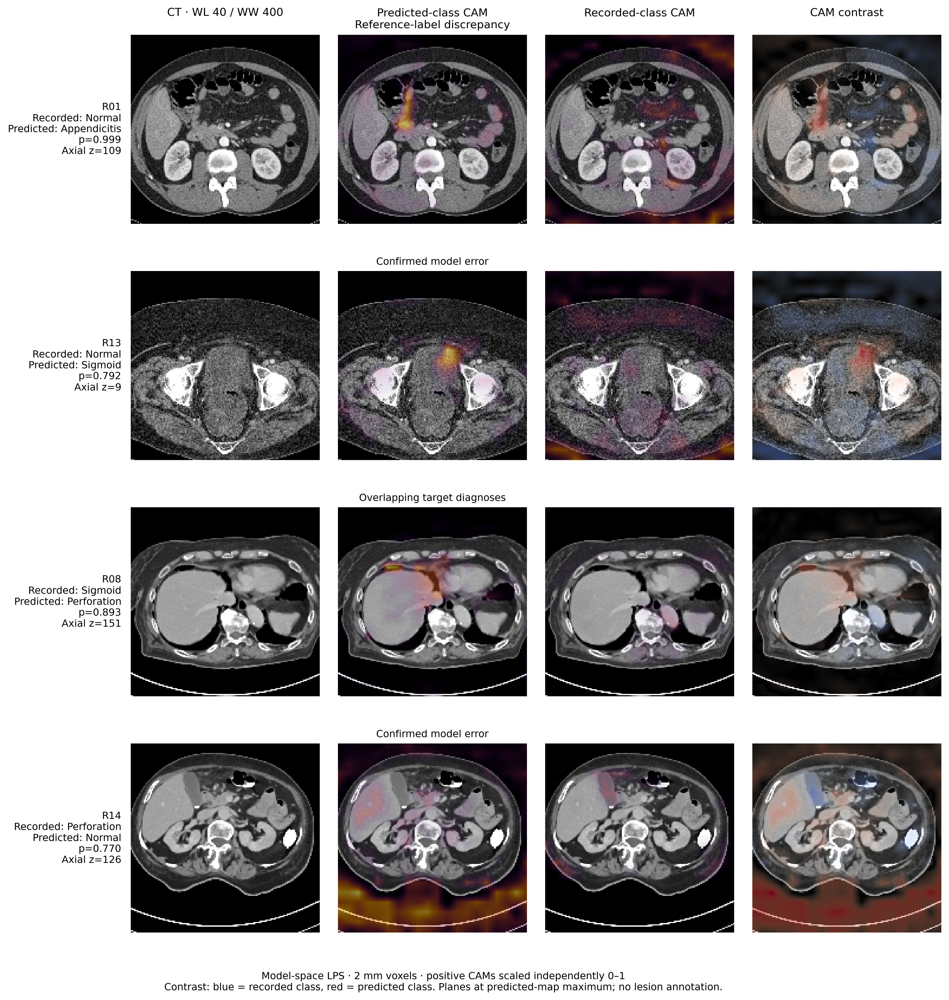

# Systematic Methodology - Performed Experiment

The performed five-class abdominal CT study: **13 supervised pipelines**, five
development sizes, a fixed **278-patient held-out cohort**, selected trained
checkpoints, and the latest publication analysis. This is the `experiment` branch of [https://github.com/IDKIS-Lab-JWK/systematic-methodology](https://github.com/IDKIS-Lab-JWK/systematic-methodology);
the `main` branch provides the reusable framework.

## Case study: all 20 FlexiCT misclassified patients

**Start with the [complete 61-page case-study PDF](Case_Study/FlexiCT_20_Case_Study.pdf).**
Every case includes the radiologist interpretation, model Grad-CAM in three
planes, and its CT overview. Public review labels R01-R20 are used throughout.
The [output interpretation guide](Case_Study/FlexiCT_Output_Guide.pdf) explains
heatmaps, occlusion, fold variation and interpretation limits.



These are all 20 disagreements from FlexiCT final-block fine-tuning with the
five-fold ensemble at the complete development size. The radiologist reread
includes reference-label discrepancies, overlapping diagnoses, other disease,
and confirmed model errors. **Original labels and all cases remain in reported
performance calculations.** R20 retains provisional linkage. This is exploratory
post-test analysis, not independent adjudication or a new validation cohort.

[Read the case-study guide](Case_Study/README.md), or inspect the complete
[three-plane and CT figure atlas](Notebooks/Publication_Results/output_4/README.md).

## Latest publication analysis

- [Publication_Results_4.ipynb](Notebooks/Publication_Results/Publication_Results_4.ipynb)
- [Saved HTML edition (download and open locally)](Notebooks/Publication_Results/output_4/Publication_Results_4.html)
- [Main tables](Notebooks/Publication_Results/output_4/main/tables/)
- [Supplementary tables and radiologist summaries](Notebooks/Publication_Results/output_4/supplementary/tables/)
- [Detailed results and interpretation](Notebooks/Publication_Results/output_4/Detailed_Results_and_Interpretation_4.html)

Only the latest publication notebook and its companion scientific code/output
are included. Scientific results and image galleries are retained. Saved audit
displays and local identifiers are removed from the public copy. Internal audit
outputs, identifier linkage and verbatim correspondence are not distributed.
The original local notebook remains unchanged.

## Selected trained checkpoints

The study provides **390 inference-only checkpoints**: five selected folds
plus the development refit, for each pipeline and development size. Their
**73.7 GB** of binaries are hosted on [public Google Drive](https://drive.google.com/drive/folders/1Rtn1sMIduWCzlX5z-3r1SI2v6B7FfKIT).
Git contains the catalogue and metadata, with no Git LFS or automatic weight download.
See [CHECKPOINTS.md](CHECKPOINTS.md) for verified downloads to the exact `Results/...` paths.

Each file has model/architecture/class/preprocessing metadata. The
[checkpoint catalog](provenance/checkpoints.json) records distributed and
original-source hashes. Every retained model tensor was verified against the
original and after serialization. Optimizer, scheduler, scaler and RNG state,
local paths and internal training context were removed; these files are for
inference rather than exact training resume. External pretrained assets are
required for partial/head-only checkpoints and are obtained separately.

The trained pipelines cover 3DINO linear probing/LoRA; COLIPRI native pooling
and final-block adaptation; FlexiCT linear probing/final-block adaptation;
Merlin linear probing/ConvLoRA+LLRD/full fine-tuning; Pillar0 linear probing/final
Atlas-block adaptation; MedicalNet full fine-tuning; and DenseNet from scratch.

## Run on your own data

Use the public runner and a model-specific environment:

```sh
python run.py --help
```

Testing accepts a selected compatible checkpoint and source images without
persistent test caches. You may also introduce new development data and use
supported freezing, partial/full tuning or scratch modes. New generic training
is distinct from the historical study recipe.

Read [reproduction instructions](REPRODUCING.md),
[the study protocol](protocol/README.md),
[installation](docs/INSTALLATION.md), and [runner usage](docs/USAGE.md).

Original datasets, caches, private patient-level artifacts and assistant working
files are excluded. Only the agreed public case-study images are included.
See [third-party notices and licensing status](THIRD_PARTY_NOTICES.md).

## Preview without clinical data

```sh
python run.py train --model DenseNet --method scratch --dataset examples/development.csv --splits examples/splits.json --preset smoke --dry-run --output runs/demo
```

This validates the fictional example configuration and patient partitions; it
does not read images or run training. Replace the example manifest for a real run.

## Verification

The core regression suite passed 76 tests, with two optional environment-specific
tests skipped in the core environment. Model-specific preprocessing checks were
also exercised separately. Exported checkpoints from all seven families produced
predictions on a synthetic NIfTI through the public runner. A native DenseNet121
training/checkpoint/public-inference round trip and MedicalNet custom-class and
training-scope checks passed. This is bounded software validation, not a new
clinical performance evaluation or a full retraining of every foundation model.

## Clone the performed experiment

```sh
git clone --single-branch --branch experiment https://github.com/IDKIS-Lab-JWK/systematic-methodology.git
cd systematic-methodology
python -m pip install -r scripts/requirements-download.txt
python scripts/download_checkpoints.py --list
```

Listing does not download weights. Choose a model, method, development size and
fold in [the download guide](CHECKPOINTS.md); downloading all weights is explicit.

## Licence and citation

Original code: [MIT](LICENSE). Model/checkpoint and clinical-material terms remain
separate in [THIRD_PARTY_NOTICES.md](THIRD_PARTY_NOTICES.md). Software citation
metadata is provided in [CITATION.cff](CITATION.cff); upstream references remain
in each model's profiles and documentation.
